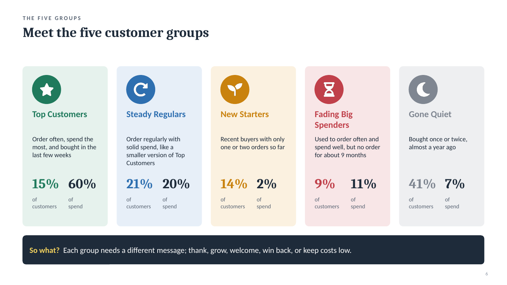
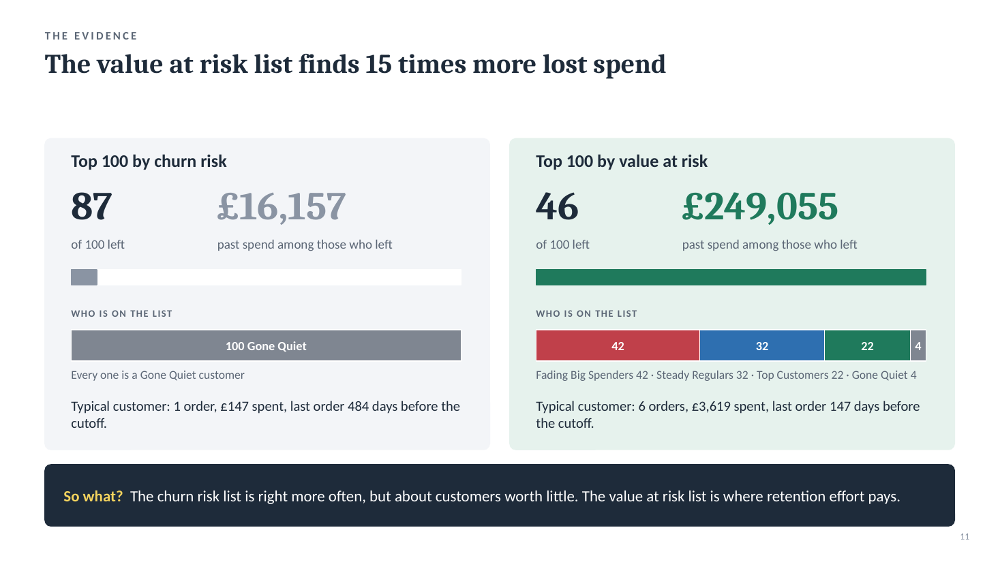

# Customer Segmentation and Churn Prediction for an Online Retailer

A UK online retailer that sells gift items, many of them to wholesalers, loses customers over time. People buy for a while and then stop. This project uses two years of sales records to answer two questions for the CRM team:

1. **Which groups of customers need a different CRM approach?** (customer segmentation)
2. **Which customers should we contact first to stop them leaving, and why?** (churn prediction)

The work is in two Jupyter notebooks, and the findings are written up as two short reports for a non-technical CRM team.



## Data

- **Source:** Online Retail II, from the UCI Machine Learning Repository, downloaded from [Kaggle](https://www.kaggle.com/datasets/mashlyn/online-retail-ii-uci).
- **Period:** 1 December 2009 to 9 December 2011.
- **Size:** about 1.07 million sales lines, reduced to 794,159 after cleaning.
- **What each row is:** one product on one invoice, with quantity, price, date, customer ID and country.
- **What is not in it:** website visits, emails, complaints, reasons for leaving and customer demographics.

The raw data is included as `data/online_retail_II.csv.gz` so the notebooks run without a separate download.

## What I did

### Notebook 1: Data cleaning and customer segmentation

- Removed duplicate rows, test entries, postage and fee lines, and two very large orders that were entered by mistake and then cancelled.
- Dropped lines with no customer ID, after checking that the ID could not be recovered from other lines on the same invoice.
- Defined churn as **no order in the 90 days after a cutoff date**, and used two cutoffs: 10 June 2011 (summer) and 9 September 2011 (the run-up to Christmas).
- Used a McNemar test to check that churn really differs between the two seasons. It does: 972 customers came back before Christmas after being quiet in summer, against 444 who went the other way (p < 0.0001).
- Scored every customer from 1 to 4 on recency, frequency and spend, and used five simple rules to place them in one of five groups. I chose rules over a clustering model because they are easy to explain and easy to rebuild inside a CRM tool.
- Checked the groups against what customers did in the next 90 days, and tracked how customers moved between groups from June to September.

### Notebook 2: Churn prediction model

- Built 16 details for each customer from data before the cutoff only, including recent activity (orders in the last 30, 90 and 180 days), buying rhythm and whether they bought in the same season a year earlier.
- Split customers 80/20 before building any model, and kept the 20% hidden until the final test.
- Compared logistic regression and gradient boosting with cross-validation. They scored almost the same, so I chose logistic regression because it is simpler to run and explain.
- Built separate models for summer and the run-up to Christmas, and tested whether one model would be enough.
- Ranked customers by **value at risk** (chance of leaving multiplied by past spend) instead of churn risk alone.
- Saved both models and produced a ranked list of every customer for each season.

## Main results

**Customer groups** (snapshot of 9 September 2011, 5,253 customers)

| Group | Share of customers | Share of spend | Placed no order in next 90 days |
|---|---|---|---|
| Top Customers | 15% | 60% | 16% |
| Steady Regulars | 21% | 20% | 40% |
| New Starters | 14% | 2% | 56% |
| Fading Big Spenders | 9% | 11% | 60% |
| Gone Quiet | 41% | 7% | 80% |

- Top Customers and Steady Regulars are 36% of customers and bring in 80% of spend.
- The chance of leaving drops the most at the third order (from 67% to 40%), so the New Starter plan aims for a third order.

**Churn model** (tested on customers the model had not seen)

| Season | Churn model AUC | RFM score AUC |
|---|---|---|
| Summer (cutoff 10 Jun 2011) | 0.851 | 0.806 |
| Run-up to Christmas (cutoff 9 Sep 2011) | 0.809 | 0.778 |

- The model ranks customers better than the RFM score in both seasons. The gain is modest, but it held in all 1,000 random re-draws of the test customers.
- Using the summer model before Christmas overstates churn by about 10 percentage points, so each season keeps its own model.
- Among the top 100 customers by value at risk, the ones who left had spent £249,055. Among the top 100 by churn risk alone, the ones who left had spent £16,157.



## Reports

The two reports are written for the CRM team, in plain language, with a recommended action for each customer group.

- [Customer segments report (PDF)](reports/01_customer_segments_crm_report.pdf)
- [Churn prediction report (PDF)](reports/02_churn_prediction_crm_report.pdf)

The PowerPoint versions are in the same folder.

## Repository layout

```
customer-churn-segmentation/
├── data/
│   └── online_retail_II.csv.gz          raw sales data (compressed)
├── notebooks/
│   ├── 01_data_cleaning_and_segmentation.ipynb
│   └── 02_churn_prediction_model.ipynb
├── outputs/
│   ├── customer_segments_holiday.csv       groups and scores, 9 Sep 2011
│   ├── customer_segments_nonholiday.csv    groups and scores, 10 Jun 2011
│   ├── crm_ranked_list_holiday_all.csv     every customer ranked by value at risk
│   ├── crm_ranked_list_nonholiday_all.csv  every customer ranked by value at risk
│   └── crm_ranked_list_holiday_test.csv    hidden test customers, used to check the ranking
├── models/
│   ├── churn_model_holiday.joblib
│   └── churn_model_nonholiday.joblib
├── reports/                              CRM reports as PDF and PowerPoint
├── images/                               pictures used in this README
├── requirements.txt
└── README.md
```

## How to run it

```bash
git clone https://github.com/<your-username>/customer-churn-segmentation.git
cd customer-churn-segmentation
pip install -r requirements.txt
jupyter notebook
```

Open the notebooks from the `notebooks` folder and run them in order. Notebook 1 creates `data/online_retail_clean.pkl`, which notebook 2 needs. That file is not in the repository because it is larger than GitHub's 100 MB file limit. Each notebook takes under a minute to run.

To load a saved model in your own code, define the `signed_log` function first, because the model uses it:

```python
import numpy as np, joblib

def signed_log(x):
    return np.sign(x) * np.log1p(np.abs(x))

bundle = joblib.load("models/churn_model_holiday.joblib")
model, features = bundle["model"], bundle["features"]
```

## Limitations

- The data covers only two years, so each season could be tested once. The models have not been tested on a later year.
- Each test group has about 1,000 customers, so AUC results can move by about 0.02 either way.
- Value at risk uses total past spend, which favours long-standing customers.
- A customer who normally orders every four months can be counted as churned after 90 days when they are only between orders.
- The ranked lists for all customers are scored by models trained on those same customers, so they are for contacting customers, not for measuring accuracy. The accuracy figures above come from the hidden test customers only.
- About 23% of sales lines have no customer ID. Those buyers are not in any group.

## Tools

Python, pandas, NumPy, scikit-learn, statsmodels, matplotlib, seaborn, Jupyter.

## Author

Nitesh Talukdar · www.linkedin.com/in/niteshtalukdar · niteshtalukdar25@gmail.com
